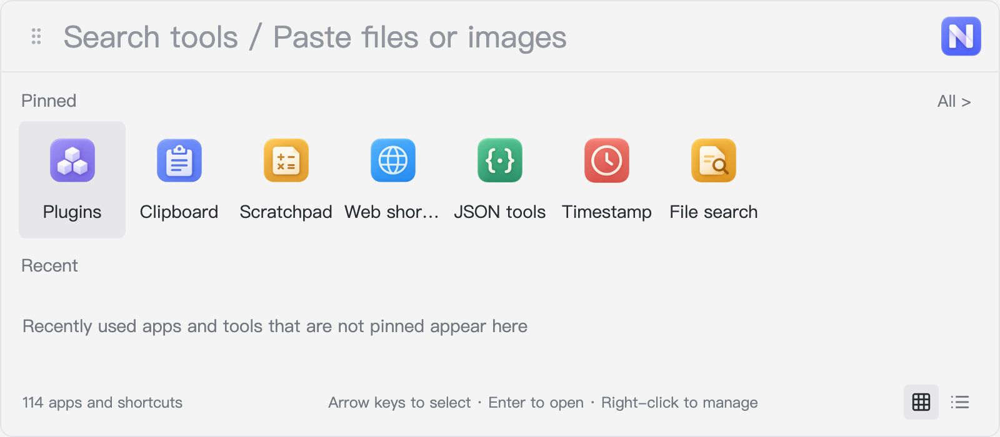
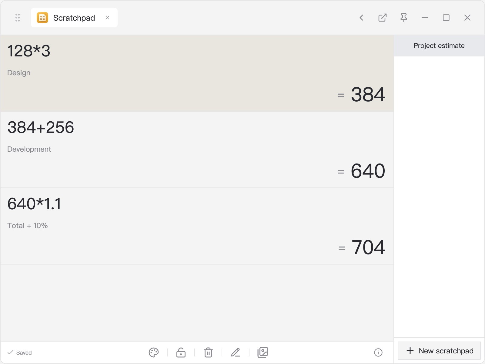
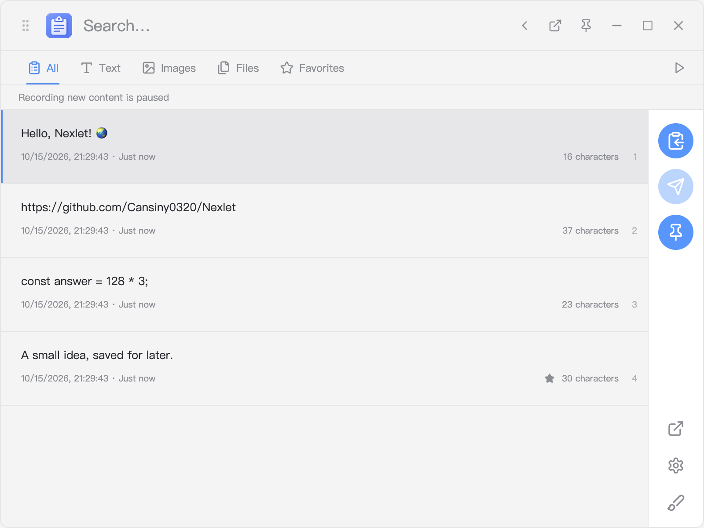
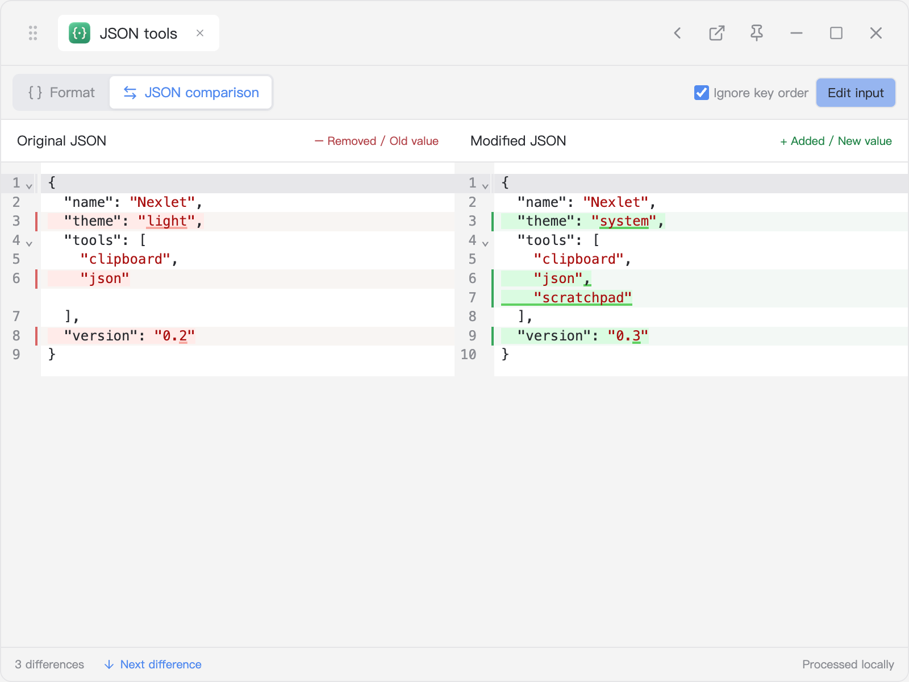
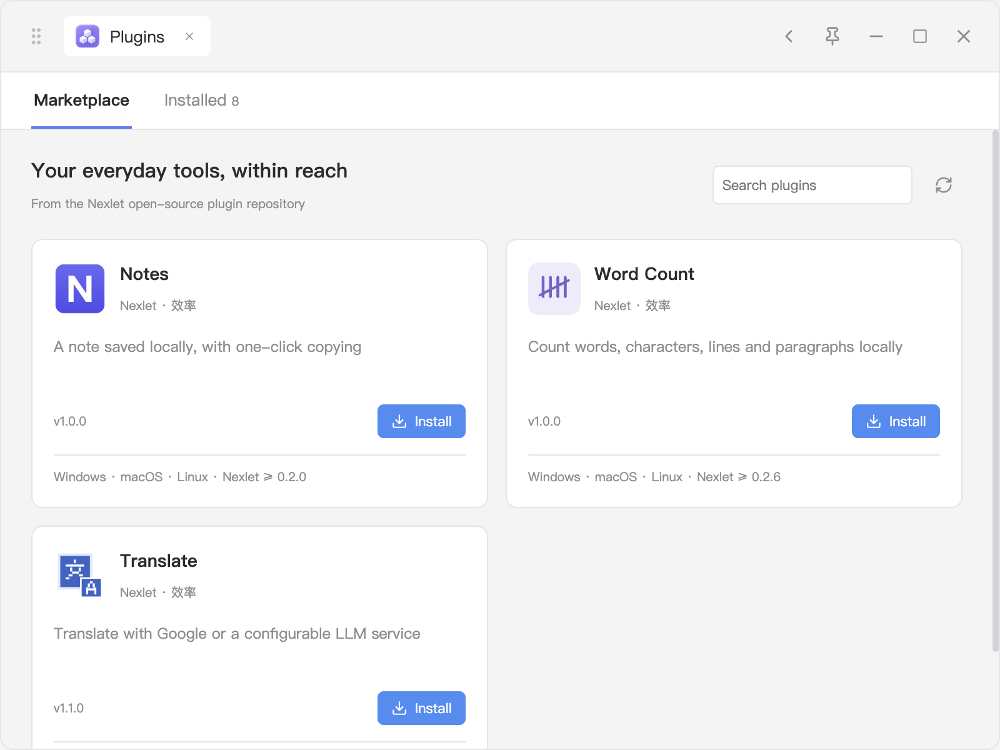

<p align="center"></p>
<h1 align="center">Nexlet</h1>
<p align="center">Your everyday tools, one shortcut away.</p>
<p align="center">
  <a href="https://github.com/Cansiny0320/Nexlet/actions/workflows/release.yml"></a>
  <a href="LICENSE"></a>
  
</p>
<p align="center">
  <a href="https://github.com/Cansiny0320/Nexlet/releases">Downloads and releases</a> ·
  <a href="https://github.com/Cansiny0320/Nexlet-plugins">Plugin repository</a> ·
  <a href="docs/plugin-sdk.en.md">Plugin development</a> ·
  <a href="website/README.en.md">Website</a>
</p>
<p align="center">
  <a href="README.md">简体中文</a> ·
  <a href="README.zh-Hant.md">繁體中文</a> ·
  <a href="README.en.md">English</a>
</p>

Nexlet is an open-source desktop toolbox with app and shortcut search, clipboard history, a calculation scratchpad, JSON tools, and plugins. The launcher keeps search, recent items, and pinned tools together. Tools can move into their own windows.

This README describes the current source and interface. For downloadable packages, check the corresponding [release notes](https://github.com/Cansiny0320/Nexlet/releases).



## Everyday actions

| Input or action | What Nexlet does |
| --- | --- |
| Press `Alt+Space`, then type an app name, pinyin, or initials | Find apps, system shortcuts, websites, and plugin commands |
| Type `128*3` | Show `384`; continue calculating line by line in the scratchpad |
| Open Clipboard | Search text, image, and file history; favorite, copy, or paste back to the previous app |
| Open JSON tools | Edit side by side, format as a tree, or compare JSON with red deletions and green additions |
| Open File search | Search with bundled Everything on Windows or Spotlight on macOS; browse folders and inspect files |
| Open Plugins | Browse the GitHub marketplace, install updates, or manage local plugins |

Timestamp, URL / Base64, UUID, and website shortcuts are also included and work offline.

<table>
<tr><td></td><td></td></tr>
<tr><td align="center">Continue calculations, annotate, lock, and autosave</td><td align="center">Text, images, files, and favorites</td></tr>
<tr><td></td><td></td></tr>
<tr><td align="center">JSON comparison with optional key ordering</td><td align="center">Browse, install, and update plugins</td></tr>
</table>

## Download and get started

Packages are available from [GitHub Releases](https://github.com/Cansiny0320/Nexlet/releases) or successful [Actions runs](https://github.com/Cansiny0320/Nexlet/actions/workflows/release.yml). Tag builds create a draft Release first. Before publication, development previews are Actions artifacts and require a GitHub login.

| Platform | Packages | Existing validation scope |
| --- | --- | --- |
| Windows x64 | Installer and portable `.exe` | Local integration tests, real external paste-back, portable startup |
| macOS Apple Silicon | arm64 `.dmg` | Native CI build and packaged startup |
| macOS Intel | x64 `.dmg` | Native CI build and packaged startup |
| Linux x64 / arm64 | AppImage and `.deb` | Local builds and X11 smoke; real GNOME/KDE Wayland pending; see [Linux guide](docs/linux.en.md) |

On Windows, install the application or run the portable EXE. Initial extraction takes longer. Closing the window leaves Nexlet in the tray; right-click the tray icon to quit. Windows packages are unsigned. Mac packages use a stable signing identity for updates, but do not yet have Developer ID signing or Apple notarization. macOS arm64 has local evidence for paste-back and accessibility permission retention across updates signed with the same certificate; this does not cover every Mac environment. See the [validation record](docs/validation.md).

See the [Linux guide](docs/linux.en.md) for installation, dependencies, and desktop limitations. Linux support in the current development source has not yet been released.

The default shortcut is `Alt+Space` (`Option+Space` on macOS). Click the Nexlet icon at the top right to open Settings. If the shortcut is occupied, change Global activation or use `Ctrl+Alt+Space` (`Control+Option+Space` on macOS). Nexlet reports conflicts without changing another app's configuration. Detached tools support always-on-top; the launcher has no pin button.

Start at login runs Nexlet in the background after sign-in. Put a portable Windows EXE in a permanent location before enabling it; enable it again after moving the file. Status is read from the operating system, and first launch does not register it automatically. macOS approval requirements appear in Settings.

Before replacing a portable EXE, choose Quit Nexlet from the tray. Opening a new EXE while the old instance runs only activates the old instance. Copy temporary JSON input before quitting. Drag the handle, tool title, or blank title-bar area to move a window; buttons and inputs retain their behavior.

### Languages

Settings offers System, Simplified Chinese, Traditional Chinese, and English. The choice persists and updates open host windows and supported plugins without clearing input. Unsupported system languages fall back to English. Search retains Chinese, English, and pinyin aliases. Notes, Word count, and Translate support all three languages; Ctool uses upstream English or Simplified Chinese, with Traditional Chinese falling back to Simplified Chinese. This describes the development source, not an already published release. See the [i18n guide](docs/i18n.en.md).

### Application updates

Released `v0.2.11` supports manual Check for updates. Automatic checking and launcher reminders below belong to the development version and are not included in that release.

Automatic checking is enabled by default: 30 seconds after launch, then every six hours, Nexlet checks published stable GitHub Releases. A new version adds a launcher reminder linking to Settings and release details. Pending updates are retained without repeated checks. Network failures do not interrupt work; the next cycle retries. Disable automatic checks in Settings to keep manual checking only.

Downloading and restarting require user action. Nexlet does not automatically download, downgrade, or install prereleases. Mac and Windows installer editions update directly. Windows portable editions offer a new EXE to replace manually. Linux AppImage supports in-app updating; deb provides a matching-architecture download for manual installation. Install a version with this capability manually the first time.

Before installation, all scratchpad windows must save successfully. Saved clipboard history, scratchpads, settings, and plugin data remain. Copy temporary JSON input before restarting. Development mode does not check for updates.

### File search

Windows bundles the official stable portable Everything engine. Opening File search prepares Nexlet's own background instance and index. With ordinary user permissions it indexes accessible files on local fixed drives. The interface reports indexing and retries while preparing; an empty query shows no files. Add directories in Settings to narrow the scope.

An initial scan may take several minutes or longer. Folder indexing without a Windows service is slower initially than Everything's native NTFS index. Nexlet installs no service or startup entry for this engine, does not control a separate Everything installation, and stops its own indexer on exit.

macOS uses Spotlight. It supports Chinese filenames, multiple terms matched together, quoted phrases, `*.pdf`, and `ext:pdf`, returning up to 200 items. Configured directories restrict queries without changing system indexing. Files excluded from Spotlight, not indexed, or not yet refreshed may be absent. Full Everything syntax and full-text search are not supported. Both platforms can open a file, reveal its folder, or copy its path. Double-click folders to browse inside Nexlet with breadcrumbs, parent navigation, and name filtering. The details pane shows path, type, size, creation time, and modification time.

Linux searches filenames on demand inside configured directories, with the same basic term, phrase, wildcard, and extension filters and a 200-result limit. Add directories first. It does not scan the whole disk and skips hidden entries and symlinks. Changing the query or closing the window cancels the old search; budget limits prompt you to narrow the scope.

### Useful shortcuts

- Right-click a search result to pin it. Drop files or paste an image to collect them in Clipboard.
- In Scratchpad, `Enter` carries the result to the next line, `Ctrl/Cmd+B` adds a note, and `Ctrl/Cmd+N` creates a sheet.
- Clipboard supports `Ctrl/Cmd` or `Shift` selection, merged text copying, deduplicated file paths, and a floating transfer window.
- For automatic paste-back, invoke Nexlet from the target app. On macOS, allow Nexlet under System Settings → Privacy & Security → Accessibility, then retry. Manual paste remains available if authorization or the target window is unavailable.
- JSON input is limited to 500,000 characters and preserves large integer source text. Object key ordering can be ignored; array ordering always matters.

### Content input and detached tools

The launcher accepts text, images, and files and suggests compatible tools. Pasted or dropped resources remain as an input card while you type keywords. Canceling does not write to the clipboard.

Detach to a separate window preserves work. External plugins keep the same page state. Built-in tools retain JSON input, clipboard filters and selection, the active scratchpad and cursor, or file search and browsing location. Save or restoration failure leaves the original tool open. JSON undo history is not transferred; file search reruns in the new window.

## Marketplace and plugin development

The public [Nexlet-plugins](https://github.com/Cansiny0320/Nexlet-plugins) marketplace uses a versioned JSON catalog and GitHub Release packages. Available plugins include Notes, Word count, and Translate; consult the catalog for versions. Install runs directly after clicking, without another permission confirmation. Marketplace plugins check for compatible updates when opening a new session: up to two seconds for the index and ten seconds for download. Failure keeps the old version, data, and input. Running plugins are not restarted; they check after closing and reopening. Imported packages and development directories are not automatically overwritten. Manual refresh and update remain available.

Plugins use Nexlet's own API and consist of HTML, CSS, JavaScript, and `plugin.json`. Import development directories or `.zip` / `.nexlet` packages. Their frontends run in separate sandboxes, embedded by default or detached. They have no Node.js, arbitrary host IPC, or direct `fetch`; network access requires `network.request` and the host bridge. Installed plugins use their declared capability without per-address confirmation.

Start with [`examples/hello-nexlet`](examples/hello-nexlet) and select it under Plugins → Installed → Load development directory. See the [Plugin SDK](docs/plugin-sdk.en.md) for APIs, permissions, icons, and packaging. Nexlet does not support uTools `.upx` packages or `window.utools`.

## Local data

Clipboard history, scratchpads, settings, and plugin data stay on the machine. Nexlet has no account, cloud sync, or telemetry. Updates and the marketplace contact GitHub. JSON tools and local file search do not upload input. Network plugins such as Translate send requests to their selected service; LLM translation uses the user's configured endpoint.

| Platform | Default directory |
| --- | --- |
| Windows | `%APPDATA%/Nexlet` |
| macOS | `~/Library/Application Support/Nexlet` |
| Linux | `${XDG_CONFIG_HOME:-~/.config}/Nexlet` |

Open data directory in Settings reveals this location. Quit before copying the whole directory for backup. Ordinary clipboard, scratchpad, and plugin storage has no additional encryption. Plugin `secrets` uses system `safeStorage`; without system encryption, secrets last only for the current plugin session. Clipboard defaults to 500 non-favorite entries and 30 days; favorites are not automatically deleted. File history stores paths, not copies of files.

## Local development

Use Node.js 24+ and npm; CI follows [.node-version](.node-version). Electron 44 uses asynchronous clipboard APIs.

```sh
npm ci
npm start
npm run typecheck
npm test
npm run test:e2e          # Builds the app and runs desktop integration tests
npm run package:linux    # x64 + arm64 AppImage / deb; run on Linux
npm run package:win      # Windows x64 installer and portable package
npm run package:mac      # Stable-signature universal DMG and update ZIP
npm run package:mac:local # Stable-signature native-architecture DMG and update ZIP
```

### Stable local signing

A development machine can use a long-lived self-signed code certificate rather than a new ad-hoc identity per build. The first identity change still needs authorization; permission retention must be verified with an actual upgrade.

On 2026-10-12, macOS 26.5.2 arm64 was tested with the same certificate from `0.2.2-local.1` to `0.2.2-local.2`; the user confirmed automatic paste-back worked without reauthorization. See [validation](docs/validation.md) for scope and focus interference.

`package:mac:local` reads `~/Library/Application Support/Nexlet Signing/`, or `NEXLET_SIGNING_DIR`: `identity.json` contains the certificate name, SHA-1 fingerprint, and dedicated keychain path; `certificate.cer` is public; `keychain-password` unlocks the keychain. Configure the identity and necessary current-user code-signing trust beforehand. The script does not create certificates or change trust.

```sh
npm run package:mac:local
npm run package:mac:local -- --version 0.2.2-local.1 --arch arm64
```

Defaults use `package.json` and the machine's architecture. `--version` changes only the artifact version. `release/local-signed-<version>-<arch>/` contains DMG, update ZIP, blockmap, update manifest, and `local-signing.json` with fingerprint, requirements, and package SHA-256. Missing certificates or verification failures stop the build without ad-hoc fallback. The dedicated keychain is temporarily added to the search list, then removed and locked.

Keep signing material readable only by its owner. Back up the certificate, encrypted private key, and recovery passwords together; never commit or publicly upload them. A replacement certificate changes app identity. Self-signed packages are not notarized and do not carry public Developer ID trust. Local packaging publishes nothing.

`test:e2e` uses isolated `.tmp` data and folder indexes, without scanning user disks; it temporarily uses the clipboard and restores readable original content. After building, `node scripts/smoke-marketplace.mjs` checks the live GitHub marketplace. See [validation](docs/validation.md) for native paste-back and platform limits.

Source layout: `src/main` hosts the desktop app; `src/renderer` contains UI; `src/preload` is the restricted bridge; `src/shared` holds shared types and logic; `website` is the website; `tests` contains regression tests.

## CI and releases

[Build and Release](.github/workflows/release.yml) covers Windows x64, Mac Intel / Apple Silicon, and Linux x64 / arm64 with type checks, unit tests, native packaging, and actual startup. Windows additionally runs desktop integration and portable EXE checks. Linux uses Xvfb/Openbox for packaged startup, XDG launch, file clipboard, startup registration, and cross-process paste-back. Remote status of the new Linux jobs must be confirmed after pushing. Ordinary commits and manual runs upload artifacts retained for 14 days.

Update versions in `package.json` and `package-lock.json`, commit, then push a matching `v*` tag. CI validates versions and generates Windows packages, both Mac DMG/ZIP architectures and blockmaps, both Linux AppImage/deb architectures, update manifests, example plugins, and `SHA256SUMS.txt`. It creates a **draft Release** for manual review and publication. Reruns may update drafts but never overwrite published releases. Mac architecture manifests are merged and checked for version, file size, and SHA-512.

Mac main/tag builds use Actions Secrets `NEXLET_MAC_CERTIFICATE_P12` (encrypted P12 as Base64) and `NEXLET_MAC_CERTIFICATE_PASSWORD`, with fingerprint `69397314808BC8B95C8B4AF0FBDFA53C0184FC2C`. The signing script runs only on disposable GitHub-hosted runners: import a temporary keychain, verify the fingerprint, grant administrator Code Signing trust to avoid blocking prompts, then remove trust and the keychain. Missing credentials fail the build. PR builds use ad-hoc signing without secrets. Packages remain unnotarized.

See [CONTRIBUTING.md](CONTRIBUTING.en.md) to contribute, or open an [issue](https://github.com/Cansiny0320/Nexlet/issues).

## License

Nexlet is [MIT licensed](LICENSE). Everything, ES, and other bundled components retain their own licenses; see [third-party notices](assets/vendor/everything/README.md).
