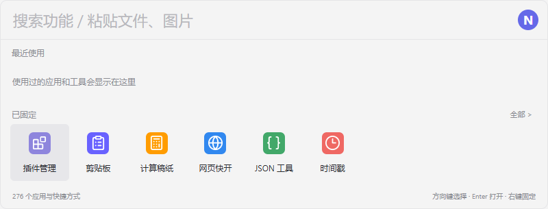
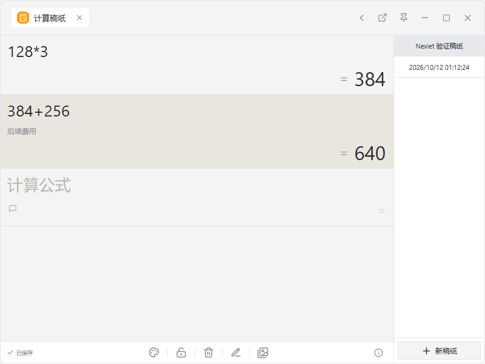
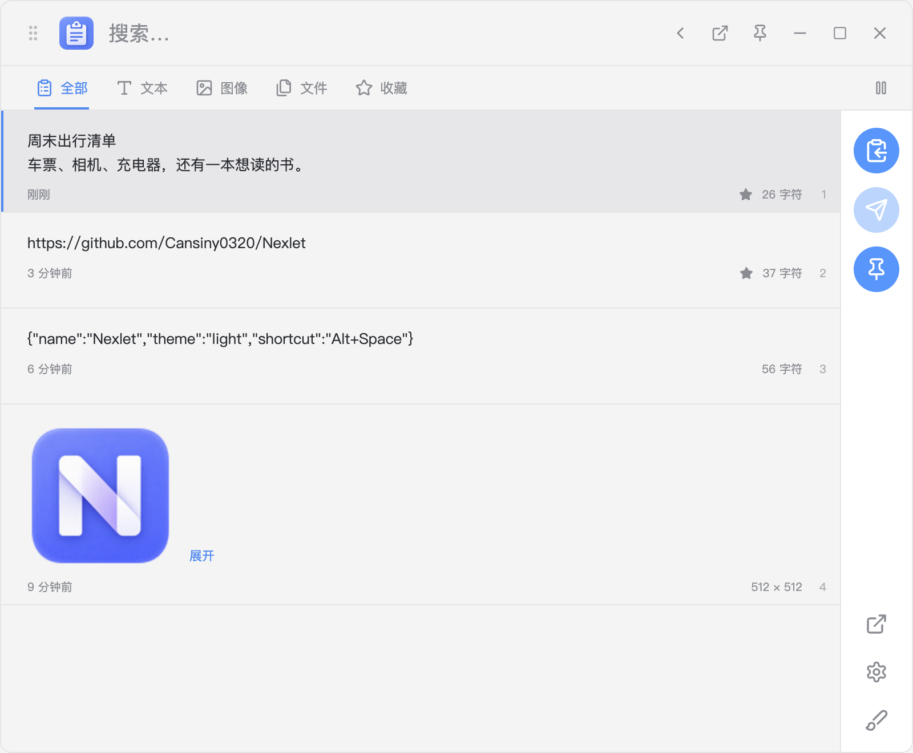
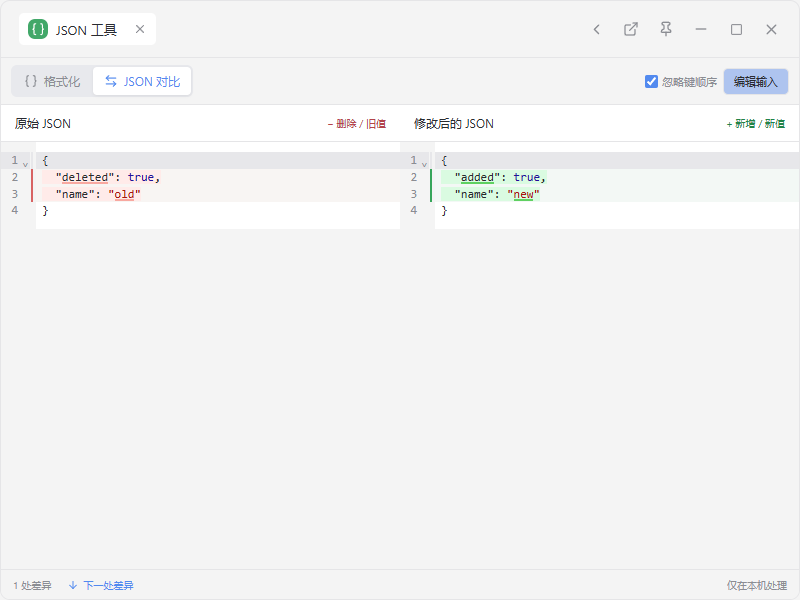
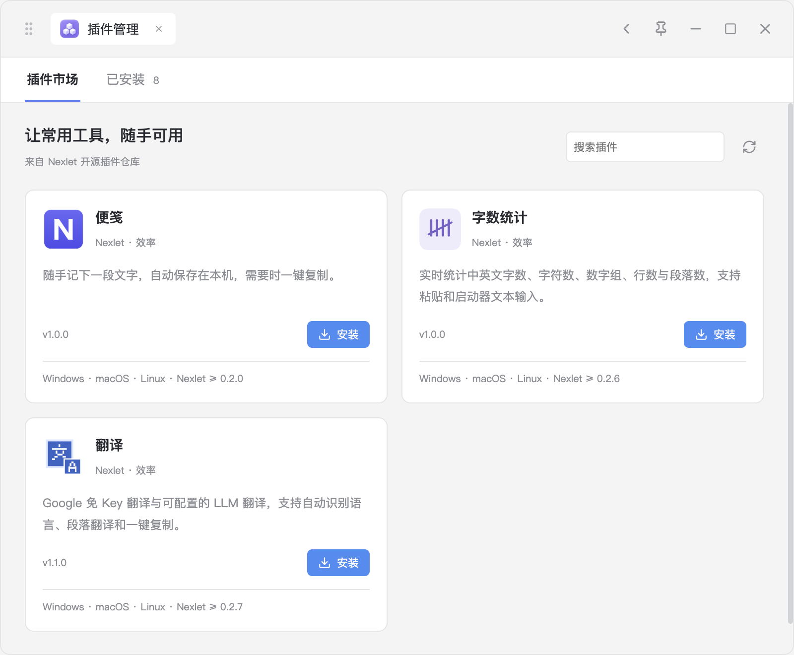

<p align="center"></p>
<h1 align="center">Nexlet</h1>
<p align="center">按下快捷键，把常用工具带到手边。</p>
<p align="center">
  <a href="https://github.com/Cansiny0320/Nexlet/actions/workflows/release.yml"></a>
  <a href="LICENSE"></a>
  
</p>
<p align="center">
  <a href="https://github.com/Cansiny0320/Nexlet/releases">下载与发行记录</a> ·
  <a href="https://github.com/Cansiny0320/Nexlet-plugins">插件市场仓库</a> ·
  <a href="docs/plugin-sdk.md">插件开发</a> ·
  <a href="website/README.md">官网</a>
</p>
<p align="center">
  <a href="README.md">简体中文</a> ·
  <a href="README.zh-Hant.md">繁體中文</a> ·
  <a href="README.en.md">English</a>
</p>

Nexlet 是一个开源桌面工具箱，提供应用与快捷方式搜索、剪贴板、计算稿纸、JSON 工具和可扩展插件。主窗口保留搜索、最近使用和固定工具，常用工具可以分离成独立窗口。

本文介绍当前源码与界面；下载安装包时，请以对应的 [发行说明](https://github.com/Cansiny0320/Nexlet/releases) 为准。



## 几个随手就能完成的操作

| 输入或操作 | Nexlet 会做什么 |
| --- | --- |
| `Alt+Space` 后输入应用名、拼音或首字母 | 查找应用、系统快捷方式、网页与插件指令 |
| 输入 `128*3` | 显示结果 `384`，可继续在计算稿纸里逐行计算 |
| 打开「剪贴板」 | 搜索文字、图片和文件历史，收藏、复制或回贴到之前的应用 |
| 打开「JSON 工具」 | 双栏编辑与树形格式化；对比两份 JSON，红色表示删除，绿色表示新增 |
| 使用「文件搜索」 | Windows 使用内置 Everything，macOS 使用系统 Spotlight，搜索本机文件、浏览文件夹并查看文件信息 |
| 打开「插件管理」 | 浏览 GitHub 插件市场，安装、更新或管理本地插件 |

其他预装工具包括时间戳、URL / Base64、UUID 和网页快开。预装工具随应用提供，离线也能打开。

<table>
<tr><td></td><td></td></tr>
<tr><td align="center">续算、备注、锁定和自动保存</td><td align="center">文本、图片、文件与收藏</td></tr>
<tr><td></td><td></td></tr>
<tr><td align="center">JSON 对比与键顺序选项</td><td align="center">浏览、安装和更新插件</td></tr>
</table>

## 下载和开始使用

构建产物位于 [GitHub Releases](https://github.com/Cansiny0320/Nexlet/releases) 或通过检查的 [Actions 运行记录](https://github.com/Cansiny0320/Nexlet/actions/workflows/release.yml)。标签构建先生成 Release 草稿；草稿公开发布前，开发预览包从 Actions artifacts 获取，需要登录 GitHub。

| 平台 | 产物 | 当前验证范围 |
| --- | --- | --- |
| Windows x64 | 安装版和单文件便携 `.exe` | 本机集成测试、真实外部回贴、便携包启动检查 |
| macOS Apple Silicon | arm64 `.dmg` | 原生 CI 构建与打包后启动检查 |
| macOS Intel | x64 `.dmg` | 原生 CI 构建与打包后启动检查 |
| Linux x64 / arm64 | AppImage 和 `.deb` | 新增本地构建与 X11 smoke；真实 GNOME/KDE Wayland 待验收，见 [Linux 说明](docs/linux.md) |

Windows 可使用安装版，或直接运行便携 EXE。首次解压会稍慢，关闭主窗口后程序保留在托盘，右键托盘可退出。Windows 包未做数字签名。macOS 正式包使用固定签名身份以支持后续更新，尚未完成 Developer ID 签名和 Apple 公证。macOS arm64 已有本机回贴与同证书升级保留辅助功能授权的验证记录；这不代表所有 Mac 环境均已验收，详见 [验证记录](docs/validation.md#macos-本机固定签名验证2026-10-12)。

Linux 安装、依赖和桌面环境限制见 [Linux 使用说明](docs/linux.md)。本次新增 Linux 支持尚未发布。

默认使用 `Alt+Space` 唤起（macOS 为 `Option+Space`）。点击启动器右上角 Nexlet 图标打开设置；若快捷键被占用，可在「全局唤起」中更换，或使用推荐的共存快捷键 `Ctrl+Alt+Space`（macOS 为 `Control+Option+Space`）；Nexlet 会提示冲突，不会修改其他程序的配置。独立工具窗口支持置顶，主启动器不显示置顶按钮。

设置中提供「开机自启动」开关，开启后随系统登录在后台运行。Windows 便携版请放在固定位置后再开启；移动 EXE 后需要重新开启开关。状态直接读取系统设置，不会在首次运行时自动登记。macOS 如需系统批准，会在设置页提示。

便携版更新时，先从托盘选择「退出 Nexlet」，再运行新版 EXE；直接双击新版会唤起仍在运行的旧实例。JSON 临时输入请在退出前复制保留。标题栏左侧手柄、工具名称及空白处可拖动窗口，按钮和输入框保留原有交互。

### 界面语言

设置中可选择跟随系统、简体中文、繁体中文或 English；偏好会保存，已打开的主窗口、独立工具和支持语言事件的插件同步更新，不清空输入。不支持的系统语言回退 English。搜索保留中文、英文与拼音别名。便笺、字数统计、翻译支持三语；Ctool 复用上游中英文，繁体回退简体。这里描述当前开发源码，尚不代表正式安装包已发布。维护规则见 [i18n 说明](docs/i18n.md)。

### 应用更新

已发布的 `v0.2.11` 支持在设置页手动「检查更新」。下述自动检查与首页提醒对应当前开发版，尚未包含在该发行版中。

默认开启自动检查更新：启动 30 秒后检查 GitHub 上已公开的正式 Release，此后每 6 小时检查一次。发现新版本后，首页显示「有新版本」，点击进入设置查看说明并选择下载；已有待处理更新时保留该版本，不重复检查。网络失败不会弹窗打断使用，下个周期自动重试。可在设置中关闭「自动检查更新」，关闭后仍可手动「检查更新」。

下载和重启安装由用户选择；不会自动下载、降级或安装预发布版本。Mac 和 Windows 安装版支持直接更新，Windows 便携版提供新版 EXE 下载入口，下载后手动替换。Linux AppImage 支持应用内更新；`.deb` 提供相同架构的新包下载入口，由用户手动安装。首次使用需手动安装带此功能的版本。

安装前会等待所有稿纸窗口保存，保存失败时中止安装。已保存的剪贴板、稿纸、设置和插件数据会保留；JSON 等临时输入请在重启前复制保留。开发模式不检查更新。

### 文件搜索

Windows 版随包提供官方稳定版 Everything 便携引擎。打开「文件搜索」时，Nexlet 开始准备自己的后台实例与索引，默认以普通权限索引本地固定磁盘中可访问的文件。索引就绪后即可输入搜索词；准备期间显示索引状态并自动重试，空输入不列出文件。可在设置中添加目录，将索引范围缩小到工作文件夹。

首次扫描可能需要几分钟或更久，界面会显示建立索引状态。这种无需安装服务的文件夹索引，比 Everything 原生 NTFS 索引的首次扫描慢。Nexlet 不安装 Windows 服务、不添加系统启动项，也不控制用户另外安装的 Everything。退出 Nexlet 时一并关闭自己的索引进程。

macOS 版使用系统 Spotlight 索引，支持中文文件名、多关键词（同时匹配）、双引号短语、`*.pdf` 通配符和 `ext:pdf` 扩展名筛选，最多展示 200 条结果。在设置中可添加文件搜索目录；这些目录只限制查询，不会改变系统索引。未索引、尚未更新或被 Spotlight 排除的文件可能无法找到。macOS 不支持完整 Everything 语法和全文检索。两端均支持打开文件、定位所在文件夹和复制路径。双击文件夹可在 Nexlet 内浏览，支持面包屑导航、返回上一级和按名称筛选；选中条目后，右侧展示完整路径、类型、大小及创建和修改时间。

Linux 使用指定目录内的即时文件名搜索，支持多关键词、双引号短语、`*.pdf` 和 `ext:pdf`，最多返回 200 条。先在设置中添加目录；不扫描全盘，跳过隐藏项和符号链接。修改查询或关闭窗口会取消旧搜索，达到时间或遍历上限时会提示缩小范围。

### 几个实用快捷操作

- 搜索结果右键固定到首页；拖入文件或粘贴图片可以收进剪贴板。
- 计算稿纸中 `Enter` 将结果带入下一行，`Ctrl/Cmd+B` 添加备注，`Ctrl/Cmd+N` 新建稿纸。
- 剪贴板支持 `Ctrl/Cmd` 或 `Shift` 多选、文本合并复制、文件路径去重与悬浮中转。
- 自动回贴需要先在目标应用中按快捷键打开 Nexlet；macOS 缺少辅助功能权限时会请求系统授权引导，请在“系统设置 → 隐私与安全性 → 辅助功能”中允许 Nexlet 后重新回贴。未授权或目标窗口不可用时仍可手动粘贴。
- JSON 支持 50 万字符以内的内容，保留大整数原文；忽略对象键顺序可选，数组顺序始终参与比较。

### 内容启动与工具分离

启动器支持文本、图片和文件输入，并推荐能处理当前内容的工具与插件。粘贴或拖放文件、图片后保留输入卡片，可继续输入关键词筛选；取消不会写入剪贴板。

点击标题栏的「分离为独立窗口」可保留当前工作内容。外部插件保留原页面状态；内置工具保留 JSON 输入、剪贴板筛选与选择、稿纸活动页和编辑位置，以及文件搜索查询与浏览位置。稿纸保存或窗口恢复失败时保留原工具。JSON 撤销历史不迁移，文件搜索会在新窗口重新查询。

## 插件市场与开发

公开市场由 [Nexlet-plugins](https://github.com/Cansiny0320/Nexlet-plugins) 托管，目录来自版本化 JSON，安装包来自 GitHub Releases。可用插件包括便笺、字数统计和翻译，具体版本以市场列表为准。点击安装后直接安装，不再弹出权限确认。市场安装的插件重新打开时自动检查并安装兼容新版；检查最多 2 秒，下载最多 10 秒，失败继续使用旧版，保留独立数据和本次输入。正在运行的插件不重启，关闭后下次打开再更新；本地导入和开发目录不自动覆盖。市场页面仍支持手动刷新和更新。

外部插件使用 Nexlet 自有 API，由 HTML、CSS、JavaScript 和 `plugin.json` 组成。支持开发目录与 `.zip` / `.nexlet` 包导入。插件在独立沙箱中运行，默认内嵌主窗口，也可分离为独立窗口；没有 Node.js、任意宿主 IPC 或直接 `fetch` 能力。需要联网的插件必须声明 `network.request` 并通过宿主 API 请求；已安装插件按声明使用该能力，不再逐地址弹窗确认。

从 [`examples/hello-nexlet`](examples/hello-nexlet) 开始，在「插件管理 → 已安装 → 加载开发目录」中选择它。完整 API、权限、图标和打包规则见 [插件 SDK](docs/plugin-sdk.md)。Nexlet 不兼容 uTools `.upx` 插件包或 `window.utools` API。

## 数据属于本机

剪贴板、稿纸、设置和插件数据存储在本机，Nexlet 本身没有账号、云同步或遥测。应用更新和插件市场会访问 GitHub；JSON 工具与本机文件搜索不上传输入内容。翻译等联网插件会将请求内容发送给其使用的服务，LLM 翻译使用用户配置的服务地址。

| 平台 | 默认数据目录 |
| --- | --- |
| Windows | `%APPDATA%/Nexlet` |
| macOS | `~/Library/Application Support/Nexlet` |
| Linux | `${XDG_CONFIG_HOME:-~/.config}/Nexlet` |

设置中的「打开数据目录」可直接定位。备份前退出 Nexlet，再复制整个目录。普通剪贴板、稿纸和插件存储没有额外加密。插件通过 `secrets` API 保存的密钥使用系统 `safeStorage` 加密；系统加密不可用时仅在当前插件会话中保留。剪贴板默认保留 500 条非收藏记录、30 天，收藏不会自动清理。文件历史只保存路径，不复制原文件。

## 本地开发

需要 Node.js 24+ 和 npm，CI 使用 [.node-version](.node-version)。Electron 44 使用异步剪贴板 API。

```sh
npm ci
npm start
```

```sh
npm run typecheck       # 类型检查
npm test                # 逻辑、数据和边界测试
npm run test:e2e         # Windows 桌面集成测试，会构建应用
npm run package:linux   # Linux x64 + arm64 AppImage / deb（在 Linux 上运行）
npm run package:win     # Windows x64 安装包和便携包
npm run package:mac     # 固定签名的通用 DMG + 更新 ZIP
npm run package:mac:local # 固定签名的本机架构 DMG + 更新 ZIP
```

### 本机固定签名

个人开发机可用长期保留的自签名代码证书构建，避免每次使用新的 ad-hoc 代码身份。首次切换身份仍需重新授权；是否保留辅助功能权限以实际跨版本升级验证为准。

2026-10-12 已在 macOS 26.5.2 arm64 上验证：同一证书从 `0.2.2-local.1` 覆盖升级到 `0.2.2-local.2` 后，用户确认无需重新授权即可自动回贴。验证范围与焦点干扰说明见 [验证记录](docs/validation.md#macos-本机固定签名验证2026-10-12)。

`package:mac:local` 读取仓库外的 `~/Library/Application Support/Nexlet Signing/`（可通过 `NEXLET_SIGNING_DIR` 指定其他目录）：`identity.json` 保存证书名称、SHA-1 指纹和专用钥匙串路径，`certificate.cer` 为公开证书，`keychain-password` 用于解锁该钥匙串。签名身份应提前配置并仅按需要授予当前用户的代码签名信任，脚本不会创建证书或调整信任设置。

```sh
npm run package:mac:local
npm run package:mac:local -- --version 0.2.2-local.1 --arch arm64
```

默认使用 `package.json` 版本和本机架构；`--version` 只覆盖产物版本，不修改源码版本。输出位于 `release/local-signed-<版本>-<架构>/`，包含 DMG、更新 ZIP、blockmap、更新清单与 `local-signing.json`（证书指纹、签名条件、安装包 SHA-256）。缺少证书或签名校验失败会直接报错，不退回 ad-hoc。构建期间临时加入专用钥匙串搜索路径，结束后移除并锁定钥匙串。

签名目录应仅当前用户可读，证书与加密私钥、恢复所需密码须一起妥善备份；不要提交或公开上传。更换证书会改变应用身份。自签名产物未经过 Apple 公证，不提供 Developer ID 的公开分发信任；本地打包不会发布任何附件。

`test:e2e` 使用 `.tmp` 中的隔离数据和文件夹索引，不扫描用户磁盘；会暂时使用剪贴板并恢复可读取的原内容。实时 GitHub 市场验收可在构建后运行 `node scripts/smoke-marketplace.mjs`。原生回贴专项与平台限制见 [验证记录](docs/validation.md)。

仓库结构：`src/main` 为桌面宿主，`src/renderer` 为界面，`src/preload` 为受限桥接，`src/shared` 为共享类型与逻辑，`website` 为官网，`tests` 为回归测试。

## CI 与发版

[Build and Release](.github/workflows/release.yml) 配置覆盖 Windows x64、macOS Intel / Apple Silicon、Linux x64 / arm64：类型检查、单元测试、原生打包、实际启动；Windows 额外运行桌面集成与便携 EXE 验证；Linux 使用 Xvfb/Openbox 验证打包启动、XDG 应用启动、文件剪贴板、自启动和跨进程回贴。新增 Linux 任务的远端运行状态需在推送后确认。普通提交和手动运行上传保留 14 天的 artifacts。

发版时更新 `package.json` 和 `package-lock.json` 的版本，提交后推送匹配的 `v*` 标签。CI 验证标签一致性，生成 Windows 安装版和便携版、两种 Mac 架构的 DMG/ZIP、blockmap、两种 Linux 架构的 AppImage/deb、更新清单、示例插件与 `SHA256SUMS.txt`，创建 **Release 草稿**，审核后手动公开发布。重跑可更新草稿，不覆盖已发布版本。双架构 Mac 清单会合并，并校验版本、文件大小和 SHA-512。

Mac 的 main / 版本标签构建使用 `NEXLET_MAC_CERTIFICATE_P12`（加密 P12 的 Base64）和 `NEXLET_MAC_CERTIFICATE_PASSWORD` 两项 Actions Secrets，证书指纹固定为 `69397314808BC8B95C8B4AF0FBDFA53C0184FC2C`。脚本仅允许在一次性 GitHub 托管 runner 中执行：导入临时钥匙串、校验固定指纹，并用管理员 Code Signing 策略信任该证书，避免用户级信任弹窗阻塞；结束时移除信任和钥匙串。凭据缺失即失败。PR 构建仅使用 ad-hoc 签名，不接触凭据。签名仍未经过 Apple 公证。

贡献方式见 [CONTRIBUTING.md](CONTRIBUTING.md)。问题与建议可提交到 [Issues](https://github.com/Cansiny0320/Nexlet/issues)。

## 许可证

Nexlet 使用 [MIT License](LICENSE)，允许使用、修改和分发。Everything、ES 与其他第三方组件保留各自许可证，见 [第三方组件说明](assets/vendor/everything/README.md)。
