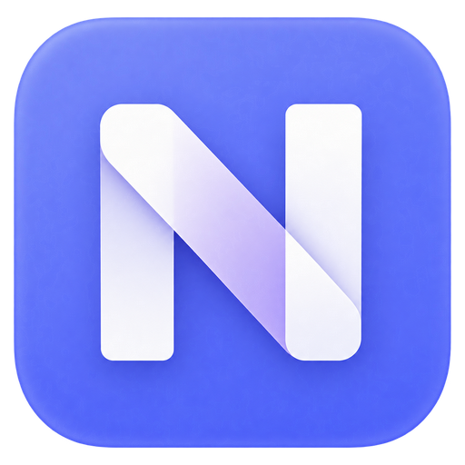
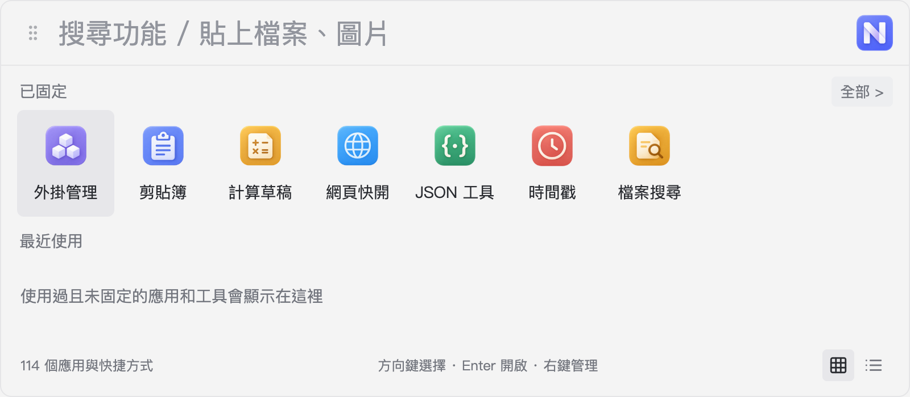
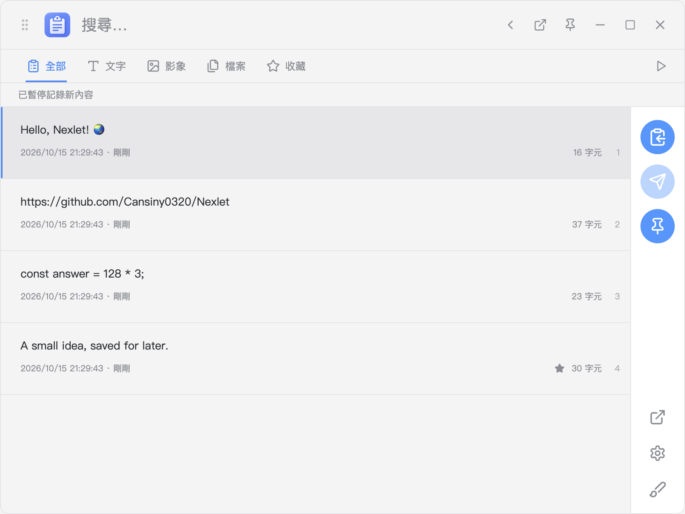
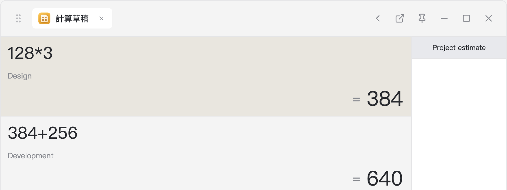
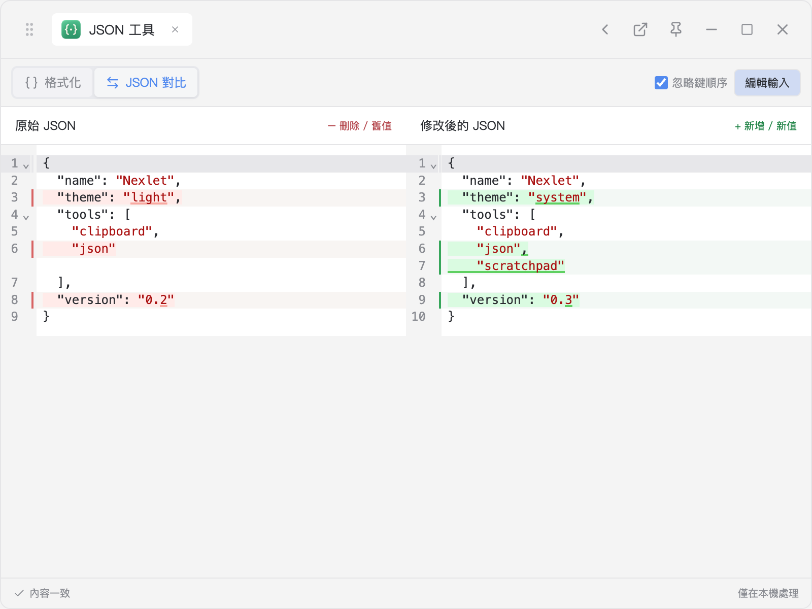
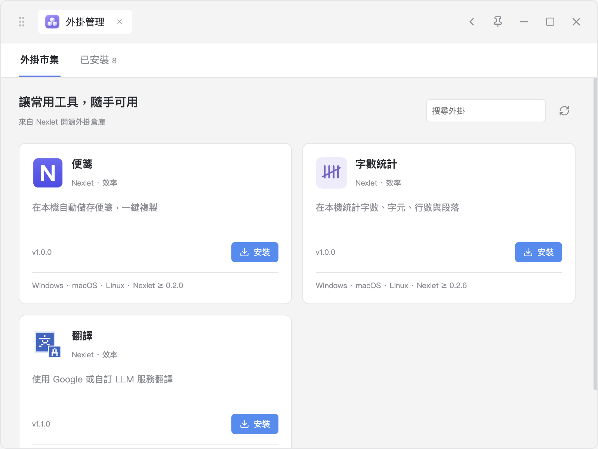

<h1 align="center">Nexlet</h1>

按下快速鍵，把常用工具帶到手邊。

  
  
  

  <a href="https://github.com/Cansiny0320/Nexlet/releases/latest">下載</a> ·
  <a href="https://github.com/Cansiny0320/Nexlet-plugins">外掛市場</a> ·
  <a href="https://github.com/Cansiny0320/Nexlet/issues">問題回報</a> ·
  <a href="https://nexlet.cansiny0320.chatgpt.site/zh-Hant/">官網</a>

  <a href="README.md">简体中文</a> ·
  <a href="README.zh-Hant.md">繁體中文</a> ·
  <a href="README.en.md">English</a>

Nexlet 是一個開源桌面工具箱。找應用程式、翻剪貼簿、做計算、處理 JSON，都可以從同一個搜尋框開始；需要常駐的工具，還能分離成獨立視窗。支援 Windows、macOS 和 Linux。

## Nexlet 能幫你做什麼？

- **少找幾個視窗**：按快速鍵搜尋應用程式、檔案、網頁和外掛指令，支援中文、英文、拼音與首字母。
- **找回剛才複製的內容**：搜尋文字、圖片和檔案歷史，收藏常用內容，再複製或貼回之前的應用程式。
- **隨手計算和處理文字**：輸入 `128*3` 直接得到 `384`，也可以開啟計算草稿逐行計算，或用 JSON 工具格式化、檢視和比對資料。
- **按需要新增工具**：從外掛市場安裝便箋、翻譯、字數統計、離線 OCR 等工具，常用工具可以固定到首頁。

## 快速開始

**1 · 下載並安裝。** 前往 [最新版本](https://github.com/Cansiny0320/Nexlet/releases/latest)，選擇適合自己系統的安裝包。

| 系統                | 下載選擇                                   |
| ------------------- | ------------------------------------------ |
| Windows x64         | 安裝版 `Setup.exe` 或免安裝的可攜式 `.exe` |
| macOS Apple Silicon | `arm64.dmg`                                |
| macOS Intel         | `x64.dmg`                                  |
| Linux x64 / arm64   | AppImage 或 `.deb`                         |

Windows 安裝包尚未數位簽署，macOS 版本尚未經過 Apple 公證。Mac 首次開啟遇到系統提示時，請參考 [首次開啟說明](docs/mac-first-open.md)。Linux 安裝與桌面環境限制見 [Linux 使用說明](docs/linux.zh-Hant.md)。

**2 · 按快速鍵喚起。** Windows / Linux 預設使用 `Alt+Space`，macOS 使用 `Option+Space`。輸入應用程式名稱或工具名稱即可搜尋；快速鍵可在設定中修改。

**3 · 從一件小事開始。** 輸入算式、開啟「剪貼簿」找回一段文字，或把圖片、檔案拖進啟動器，選擇能處理它的工具。常用搜尋結果可以按右鍵固定到首頁。

點選啟動器右上角 Nexlet 圖示進入設定，可以切換簡體中文、繁體中文或 English，調整喚起快速鍵，也可以開啟登入時自動啟動。

## 常用工具

### 新增效率功能（v0.2.41）

目前原始碼新增快捷短語、工作區、設定匯入匯出、AI 動作、圖片文字搜尋、工具狀態恢復，並改善富文字歷史、動作選單、搜尋、記錄控制與檔案預覽。使用方式與限制見 [效率功能說明](docs/productivity.zh-Hant.md)。

### 剪貼簿與計算草稿

剪貼簿儲存文字、圖片和檔案歷史，支援搜尋、收藏、多選與合併複製。計算草稿支援逐行計算、續算、備註和自動儲存；按 `Enter` 可以把結果帶入下一行。

<table>
<tr><td width="50%"></td><td width="50%"></td></tr>
<tr><td align="center">找回文字、圖片和檔案</td><td align="center">逐行計算，保留過程與備註</td></tr>
</table>

### JSON 與檔案搜尋

JSON 工具支援雙欄編輯、樹狀檢視和差異比對，用紅色標記刪除、綠色標記新增；比對時可選擇忽略物件鍵順序。

檔案搜尋支援開啟檔案、定位資料夾、複製路徑和瀏覽目錄。Windows 內建 Everything 引擎，首次使用需要等待索引；macOS 使用 Spotlight，搜尋範圍受系統索引影響；Linux 需要先在設定中新增搜尋目錄。

時間戳記、URL / Base64、UUID 等常用工具也隨應用程式提供，離線即可使用。需要邊看邊用時，點選工具標題列的「分離為獨立視窗」，還可以將視窗置頂。

### 外掛市場

開啟「外掛管理」即可瀏覽、安裝和更新外掛，也支援匯入本地 `.zip` / `.nexlet` 外掛包。市場中的工具包括便箋、字數統計、翻譯和離線 OCR，具體以市場清單為準；離線 OCR 需要 Nexlet 0.2.30 或更新版本。

從市場安裝的外掛會在重新開啟時檢查相容更新，更新失敗時繼續使用舊版。Nexlet 使用自己的外掛體系，不相容 uTools `.upx` 外掛。

## 使用提示

- **貼回原應用程式**：在目標應用程式裡按快速鍵開啟 Nexlet，再選擇剪貼簿內容。macOS 需要在「系統設定 → 隱私權與安全性 → 輔助使用」中允許 Nexlet；未授權時仍可複製後手動貼上。
- **應用程式更新**：設定中可手動檢查更新，也可開啟自動檢查。發現新版後，由你選擇下載和重新啟動安裝。Windows 可攜版與 Linux `.deb` 需要下載後手動替換或安裝。
- **結束與替換可攜版**：關閉主視窗後，Nexlet 會保留在系統匣。替換 Windows 可攜版前，請先從系統匣選擇結束 Nexlet。重新啟動前記得保留 JSON 等暫存輸入。
- **Linux 桌面差異**：Wayland 下的全域快速鍵和剪貼簿能力取決於桌面權限，自動回貼需改用手動貼上。詳細說明見 [Linux 使用說明](docs/linux.zh-Hant.md)。

## 資料與隱私

剪貼簿、草稿、設定和外掛資料儲存在本機。Nexlet 本身沒有帳號、雲端同步或遙測，JSON 工具與本機檔案搜尋不會上傳輸入內容。應用程式更新和外掛市場會存取 GitHub；翻譯等連網外掛會把請求內容傳送給所使用的服務。

在設定中選擇「開啟資料目錄」即可找到本機資料。需要備份時，先結束 Nexlet，再複製整個目錄。一般剪貼簿、草稿和外掛資料沒有額外加密；檔案歷史只儲存路徑，不複製原始檔案。

## 回饋與參與

遇到問題或有功能建議，歡迎提交 [Issue](https://github.com/Cansiny0320/Nexlet/issues)，並附上系統、Nexlet 版本和重現步驟。

想參與專案，可以查看 [貢獻指南](CONTRIBUTING.zh-Hant.md)；想製作外掛，可以查看 [外掛 SDK](docs/plugin-sdk.zh-Hant.md) 和 [外掛倉庫](https://github.com/Cansiny0320/Nexlet-plugins)。

## 授權條款

Nexlet 使用 [MIT License](LICENSE)。Everything、ES 與其他第三方元件保留各自的授權條款，見 [第三方元件說明](assets/vendor/everything/README.md)。
