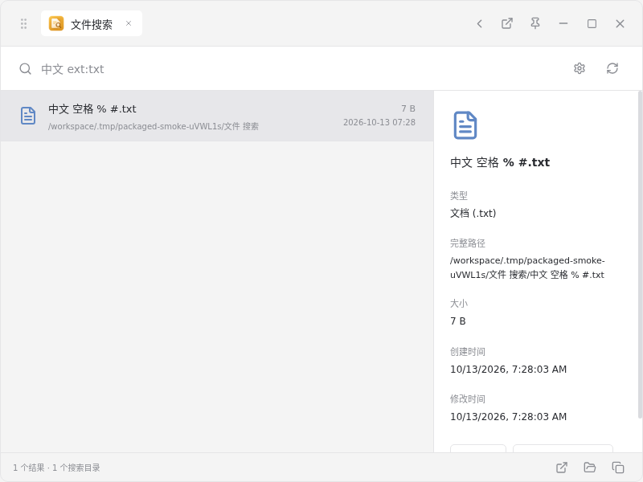
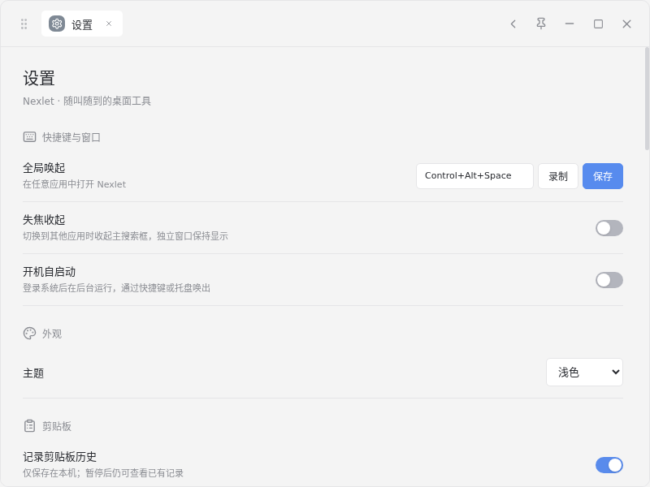

# Linux 支持验证（2026-10-13，Asia/Shanghai）

本次仅本地实现、构建和验证，未执行提交、推送或发布。工作区有其他并行改动，本记录基于构建时的完整工作区快照，不能只用 Git HEAD 复现。

- 安装包内版本：`0.2.13`（沿用当时工作区版本）。
- 源码传输归档 SHA-256：`a10bdd7f086e52c1bf3ad59538633ab699877b4c6bea2ca0593163528cadbe47`。
- 构建环境：Debian 12 Linux aarch64 容器、Node.js 24、Electron 44.7.0、electron-builder 26.15.3、Ruby fpm。
- 本机产物目录：`release/linux-preview-0.2.13`，包含四个安装包、两份更新清单、SHA256SUMS.txt 和 validation.json。

## 已验证

| 检查 | 结果 |
| --- | --- |
| Linux `npm run typecheck` | 通过 |
| Linux `npm test` | 391 通过，2 个 macOS 原生测试跳过 |
| `npm run package:linux` | x64 + arm64 AppImage/deb 四个产物成功 |
| 架构 | 两种架构的 Electron 可执行文件与 koffi ELF 头匹配目标，deb 的 amd64/arm64 元数据正确 |
| 更新元数据 | 每个架构的文件名、版本、大小、SHA-512 与真实产物匹配 |
| 导出文件 | 复制回本机后逐文件 SHA-256 再校验通过 |
| AppImage 启动 | arm64，`APPIMAGE_EXTRACT_AND_RUN=1`，实际 AppImage 入口启动通过，自动更新模式正确 |
| deb 内应用 | arm64，解包后实际可执行文件启动通过，手动下载更新模式正确；desktop-file-validate 通过 |
| XDG 应用 | desktop 条目扫描、图标解析、gio 启动独立脚本并回读落盘标记通过 |
| 剪贴板 | 文本后台记录、含中文/空格/百分号路径的文件往返通过；两种原生 MIME 均回读成功 |
| 自动回贴 | 真实全局快捷键唤起 Nexlet，恢复另一个 Electron 进程的窗口并粘贴文本通过 |
| 登录自启动 | 隔离 XDG 配置目录中开启、状态回读、关闭通过 |
| 文件搜索 | 指定目录内真实文件查询、界面显示与中文字体检查通过 |
| 计算稿纸 | 打包运行计算 `128*3=384` 通过 |

## 运行命令

容器内安装 GTK/NSS/GIO、xdotool、Xvfb、Openbox、中文字体和 fpm 后执行：

```sh
npm run typecheck
npm test
USE_SYSTEM_FPM=true npm run package:linux
# 两个 smoke 分别运行在独立 Xvfb + D-Bus 会话中；Openbox 提供焦点管理。
APPIMAGE_EXTRACT_AND_RUN=1 dbus-run-session -- xvfb-run -a sh -c 'openbox & node scripts/smoke-package.mjs release/Nexlet-0.2.13-Linux-arm64.AppImage'
dpkg-deb -x release/Nexlet-0.2.13-Linux-arm64.deb .tmp/linux-deb-verify
desktop-file-validate .tmp/linux-deb-verify/usr/share/applications/app.nexlet.desktop.desktop
dbus-run-session -- xvfb-run -a sh -c 'openbox & node scripts/smoke-package.mjs .tmp/linux-deb-verify/opt/Nexlet/nexlet'
```

## 本次发现并修复

- electron-builder 对 x64 使用 `x86_64.AppImage` / `amd64.deb`，更新下载和资产校验已按实际名称处理。
- npm 在 arm64 构建机上只装 arm64 的 koffi 可选依赖；跨架构脚本按 lockfile SHA-512 补齐 x64 包并验证 ELF，避免只生成外壳却无法启动。
- deb 需要项目 homepage；已添加现有 GitHub 仓库地址。
- 精简 Linux 缺少中文字体会显示方框；deb 推荐依赖、CI 和使用文档已补充 `fonts-noto-cjk`。

## 尚未验证

- x64 原生桌面启动（本机为 arm64；已配置原生 x64 CI，但本次没有触发远端运行）。
- 真实 GNOME/KDE Wayland 的 portal 授权、后台剪贴板与焦点行为。
- AppImage 跨版本下载后替换/重启全过程，以及真实系统登录自启动。
- 发行版实际 apt 安装及 Chromium sandbox：本次 deb 使用解包验证，Playwright smoke 使用测试启动参数，不能等同于真实桌面的 sandbox 验收。
- 未发布 Linux Release，官网也未部署更新。

## 界面




