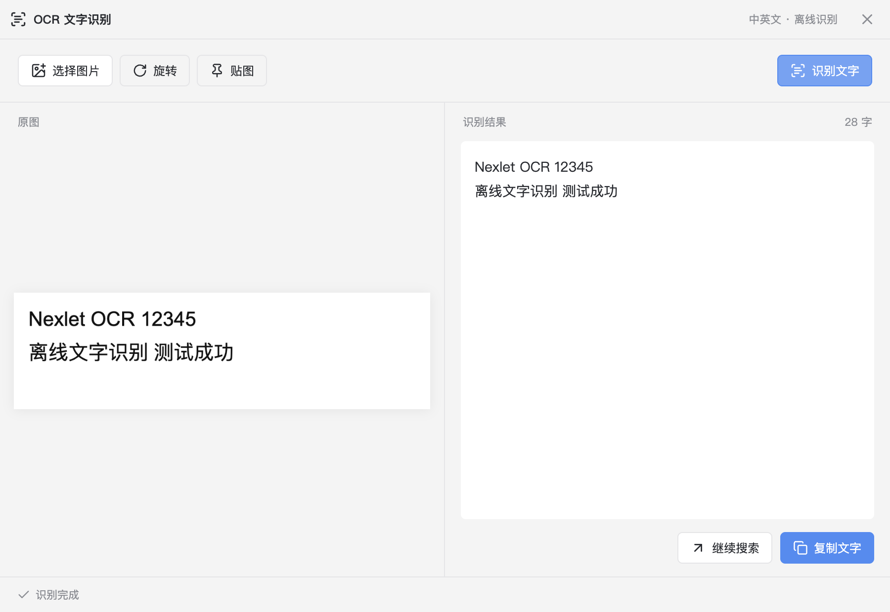

# 窗口管理、截图、贴图与 OCR 验证及对比

> 后续更新：OCR 已替换为 PaddleOCR.js + PP-OCRv6，见 [替换验证](paddle-ocr-2026-10-13.md)。本文保留首轮实现记录。

2026-10-13。已按批准方案完成本地实现和验证，未提交、推送、安装或发布。本工作区同时有其他会话的改动；下面仅描述本批范围。

## 对比基线

- uTools 宿主：本机 7.8.0 的截图、贴图静态实现，结合[官方产品说明](https://www.u-tools.cn/docs/guide/about-uTools.html)。静态代码用于确认能力边界，不代表已逐项运行 uTools 验证。
- 窗口布局：[市场「窗口管理器」1.0.8](https://www.u-tools.cn/plugins/detail/%E7%AA%97%E5%8F%A3%E7%AE%A1%E7%90%86%E5%99%A8/)，开发者周永强；这是第三方插件，不是 uTools 宿主内置窗口布局。
- OCR：[官方使用说明](https://www.u-tools.cn/docs/guide/plugin-ocr.html)和[官方 OCR 插件](https://www.u-tools.cn/plugins/detail/OCR%20%E6%96%87%E5%AD%97%E8%AF%86%E5%88%AB/)。本批对齐入口与处理流程，不声称识别准确率、表格或公式能力相同。

## 逐项结果

| 能力 | Nexlet 本批结果 | 验证与差距 |
| --- | --- | --- |
| 左、右、上、下半屏 | 4 种布局均已实现 | 几何单测；macOS 真机左右分屏 |
| 左上、右上、左下、右下四分屏 | 4 种布局均已实现 | 几何单测 |
| 左、中、右三分屏 | 3 种布局均已实现 | 几何单测 |
| 左、右 2/3 屏 | 2 种布局均已实现 | 几何单测 |
| 最大化、居中 | 2 种布局均已实现，共 15 种 | 按显示器工作区布局，不强制退出 macOS 系统全屏 |
| 连续左右半屏切换显示器 | 已实现 | 多屏、负坐标单测；没有物理多屏真机验收 |
| 移到上一屏、下一屏、恢复位置 | 已实现 | 恢复初始几何真机通过；多屏移动为自动化证据 |
| 操作唤起前的具体窗口 | 使用 macOS AX 窗口对象或 Windows HWND/PID | 同一应用两个窗口的真机测试，只修改目标窗口；关闭后的目标被拒绝 |
| 区域截图、当前屏截图 | 已实现 | 区域交互、当前屏像素输出 E2E；macOS 真实屏幕截图通过 |
| 混合 DPI、跨屏裁切 | 按源图片实际像素比例组合 | 单测覆盖不同缩放率、负原点和跨屏区域；真机确认 Retina 像素比例 |
| 截图取消、显示器变化 | Esc/右键取消；显示器配置变化取消 | E2E 确认取消不改剪贴板、销毁窗口不抛异常 |
| 复制、保存 PNG、送入主搜索框 | 已实现 | 当前屏复制、图片保存、宿主 `from: capture` 输入和功能匹配通过 |
| 截图后贴图、OCR、OCR 直接复制 | 已接入同一输出路由 | 复用图片工具与识别执行器；直接复制的成功、空结果、取消、冲突路径均有回归 |
| 贴图置顶、拖动、缩放、旋转 | 已实现；标题栏与图片区域可拖动 | 置顶/原生拖动区域由 Electron 提供；E2E 验证缩放和旋转后的真实图片尺寸 |
| 贴图复制、保存、送回搜索、关闭 | 已实现 | 保存与送回搜索 E2E；关闭释放会话 |
| 图片 OCR、截图 OCR、识别复制 | 已实现中英文离线文字识别 | 真实中英文图片、真实屏幕裁片及打包产物均通过 |
| 文件、粘贴、拖入、选图输入 | 已实现，最多 20 MB / 3600 万像素 | 宿主资源授权沿用现有 token 生命周期；renderer 无法伪造截图来源 |
| OCR 编辑、复制、继续搜索 | 已实现 | 编辑后旋转保留文本；复制真实剪贴板、转主窗口内容输入通过 |
| OCR 进度、取消、超时、错误 | 已实现 | worker 取消、迟到结果、空结果、崩溃、模型缺失、60 秒超时单测 |
| OCR 直接复制时用户又复制其他内容 | 保留用户新内容并展示识别结果 | 通过剪贴板版本/内容校验；E2E 通过 |
| 别名、收藏、禁用、快捷键、超级面板 | 接入共享命令目录和执行器 | 入口回归通过；禁用 OCR 同时拦截图片输入与功能快捷键 |
| OCR 翻译、表格、公式 | 未实现 | 按批准方案列为差距；未接翻译服务或结构化 OCR |
| 滚动长截图、完整标注编辑器 | 未实现 | 不在本批范围 |
| 任意外部窗口置顶 | 未实现 | 本批只包含外部窗口布局；贴图窗口置顶已实现 |

## 可复核证据

- `npm test`：55 个文件、423 项单测通过。
- `npm run typecheck`、`npm run build`、`git diff --check`：通过。构建校验随包 OCR 模型 SHA-256，不自动下载模型。
- `npx playwright test tests/window-capture-ocr.spec.ts tests/entry-alignment.spec.ts tests/super-panel.spec.ts`：23 项通过，其中本批 7 项覆盖截图、贴图、OCR 和关闭回归。
- macOS 原生窗口：见 [window-native-macos-2026-10-13.json](window-native-macos-2026-10-13.json)。原始窗口 `100,120,640,420`，分屏后恢复完全一致，另一个窗口未改变。
- macOS 原生截图：见 [capture-native-macos-2026-10-13.json](capture-native-macos-2026-10-13.json)。624×372 逻辑像素区域生成 1248×744 实际像素；识别出 `Nexlet native OCR 98765` 和 `离线文字识别 测试成功`。本机该次裁切加识别耗时 568 ms，仅是一个清晰测试样本，不代表通用性能或准确率。
- 本地 macOS arm64 目录产物：`.tmp/window-capture-package/mac-arm64/Nexlet.app`。通过 `NEXLET_E2E_EXECUTABLE=<产物中的 Nexlet 可执行文件> npx playwright test tests/window-capture-ocr.spec.ts --grep 真实离线`，1 项通过。确认 packaged app 能从 `app.asar.unpacked` 加载 worker、WASM 与中英文模型。该产物未签名、未安装、未发布。
- 中英文模型压缩文件合计 4,671,641 bytes，Tesseract core 目录约 43 MiB，另有约 0.9 MiB 的两个 worker bundle；这是相关文件体积，不是安装包增量测量。OCR 使用本地模型，不上传图片。

## 运行边界与报错修复

macOS 已完成真实窗口、截图和 OCR 验证。Windows 原生适配已实现，但没有 Windows 真机结果。Linux 截图采用 Electron/PipeWire 选择的屏幕源；无法对应显示器时显示预览再框选，本批没有 Linux 真机验收。Linux 外部窗口布局明确不支持。系统辅助功能和屏幕录制权限仍由用户在系统设置中授予。

用户反馈的第一处 `Object has been destroyed` 来自截图窗口关闭回调读取 `window.webContents.id`；现已在创建时保存 owner，关闭时只用保存的值。取消截图、完成截图、关闭贴图和关闭后重开 OCR 已回归通过。

后续来自 `titlebar-install-20261013-163215` 的异常是并行拖动模块的关闭回调读取 `window.webContents`；对应会话已在共享源码中提前保存 `contents`。本批最终构建与 23 项入口回归使用该修正版，未改写该会话的隔离目录或安装产物。

## 主要文件

- `src/main/window-actions.ts`、`src/main/window-native.ts`、`src/shared/window-layout.ts`：布局、目标身份、恢复与多屏。
- `src/main/screen-capture.ts`、`src/shared/capture.ts`、`src/renderer/Capture.tsx`：冻结屏幕、裁切与输出。
- `src/main/desktop-tools.ts`、`src/renderer/ImageTools.tsx`、`src/preload/desktop-tools.ts`：贴图、OCR 窗口和隔离 IPC。
- `src/main/ocr.ts`、`src/main/ocr-worker.ts`、`assets/vendor/ocr`：本地识别、worker 生命周期与模型。
- `tests/window-capture-ocr.spec.ts`：本批可重复运行的端到端回归。

## 试用反馈修复与 OCR 候选对照（2026-10-13）

- 修复截图权限流程：在 macOS 未授权时调用 `CGRequestScreenCaptureAccess`，仍未获准则自动打开系统的屏幕录制设置页。开始申请前标记截图忙状态，失败后释放；授权前不隐藏窗口或读取屏幕图像。
- 修复省略标题提示：Launcher 网格、列表以及 SuperPanel 入口的原生 `title` 同时包含完整名称与说明。
- TDD：旧代码下权限测试确认没有调用申请接口，标题测试确认缺少完整名称；修复后通过 5 项权限单测、4 项截图几何单测、9 项桌面工具 E2E、TypeScript 检查和构建。签名安装包再次通过 9 项 E2E。
- 本机安装：同一签名身份的 0.2.13 arm64 已安装并重启。实际 UI 确认完整标题出现在辅助说明中；点击截图后已打开“录屏与系统录音”设置，Nexlet 开关为关闭。未替用户授予系统权限。旧应用和用户数据保留在 `.tmp/ocr-feedback-install-20261013-173519/backup`。
- OCR 现状：仍是 Tesseract.js 7.0.0 + eng/chi_sim。未将未经确认的新引擎或不稳定的参数实验写入产品。
- 临时质量对照使用用户所发截图中的“原图”区域（381×850），不是原始图片。Tesseract 调整语言顺序或放大可改善部分字段，但又引入其他错误；Apple Vision 和 RapidOCR 3.10.0 / ONNX Runtime 1.31.0 / PP-OCRv6 small 在此样本上均正确识别金额、两行日期及对应中文标签。RapidOCR 首次调用约 1.6 秒，包含模型首次加载；单样本不代表总体准确率或稳定性能。
- 后续候选为官方 [PaddleOCR.js](https://github.com/PaddlePaddle/PaddleOCR/tree/main/paddleocr-js/packages/core) 和 [RapidOCR](https://github.com/RapidAI/RapidOCR)。引擎替换尚未批准；需要先比较更多小字、低对比度、中英文和真实截图，以及 Electron 离线打包、冷启动、内存和取消行为。
